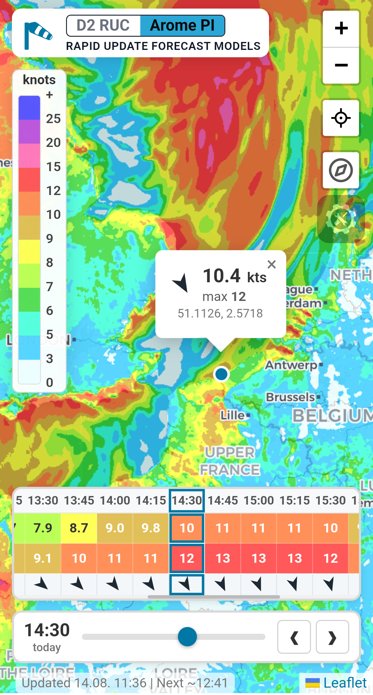

# RapidWind – ICON-D2 RUC, AROME PI & HRRR Wind Map

[](https://rapidwind.app/)
[](https://github.com/Chriz76/weather-data)

Free, ad-free wind and weather map for kite, wing foil and windsurfing. It renders three regional
rapid-update models — **ICON-D2 RUC** (DWD, 2.2 km, hourly runs), **AROME PI** (Météo-France, 2.5 km
with a 1.3 km gust field) and **HRRR** (NOAA, 3 km) — and turns any spot on the map into a point
forecast with wind, gusts, direction and the WMO weather code.

[](https://rapidwind.app/)

To our knowledge this is a **unique free implementation** of hourly updated, interactive point
forecasts from these high-resolution models.

> ⚠️ **Disclaimer:** Always check the local weather at your spot. Forecasts can be wrong. This project is currently in active development.

---

## Documentation

The user-facing documentation lives on the app itself, not in this README:

| Page | Content |
| :--- | :--- |
| **[rapidwind.app/info](https://rapidwind.app/info)** | What the app shows, how to read the map, model overview, data sources, limits, privacy |
| [ICON-D2 RUC](https://rapidwind.app/icon-d2-ruc) (German) | Update cycle, 27 h model run, resolution, where the model stops |
| [AROME PI](https://rapidwind.app/arome-pi) (French) | Immediate forecast, 6 h PI range at 15-minute steps, limits |
| [HRRR](https://rapidwind.app/hrrr-conus) (English) | 3 km grid, 15-minute steps for the first 6 h, radar assimilation, limits |

Background reading: [Why standard wind forecasts fail](https://medium.com/@christianzink/why-standard-wind-forecasts-fail-the-power-of-dwds-icon-d2-ruc-model-for-wind-sports-acf2ebd88412) ·
[Related project: kitespots.zink.tv](https://kitespots.zink.tv)

---

## Repositories

Ingestion and frontend are kept in two repositories so deployment and data pipeline stay independent:

| Repository | Role |
| :--- | :--- |
| [weather-map](https://github.com/Chriz76/weather-map) (this repo) | TypeScript/Vite frontend: map, timeline, point forecast, model pages |
| [weather-data](https://github.com/Chriz76/weather-data) | Python pipeline: GRIB2 ingestion, cropping, JSON serialization |

---

## Providers

Three rapid-update models are available; switch them with the toggle in the logo row.

| Provider | Area | Resolution | Cycle / steps on the map | Map horizon | Sources |
| :--- | :--- | :--- | :--- | :--- | :--- |
| **ICON-D2 RUC** | Germany and Central Europe | 2.2 km | hourly runs, hourly steps | 24 h | DWD ICON-D2 RUC (`dwd_icon_d2_ruc_native`) via Open-Meteo |
| **AROME PI** | France and Western Europe | 2.5 km (1.3 km gusts) | hourly runs, 15 min for 6 h, hourly after | 22 h | Météo-France via Open-Meteo |
| **HRRR** | CONUS | 3 km | hourly runs, 15 min for 6 h, hourly after | 18 h | NOAA HRRR via Open-Meteo |

The ranges above are what the data pipeline publishes. The models themselves reach further: ICON-D2 RUC
runs cover 27 h, HRRR runs go out to 48 h. Point forecasts and the WMO weather codes for all three
providers come from Open-Meteo. Why 2–3 km grids and hourly runs matter for wind sports is explained on
[rapidwind.app/info](https://rapidwind.app/info).

---

## Architecture & Data Pipeline

The project implements a decoupled, entirely serverless **Two-Repository Architecture** to eliminate backend hosting costs while maintaining high data throughput.


### 1. Data Ingestion & Extraction (`weather-data`)
* **Pipeline Branch (`main`):** A Python-based script triggered hourly via GitHub Actions fetches the latest GRIB2 payload from the DWD Open Data servers and from Open-Meteo.
* **Processing:** The pipeline crops the dataset to the target geographic bounding box, extracts wind speed arrays, and serializes the matrix data.
* **Storage Branch (`gh-pages`):** The extracted data slices are pushed as static JSON structures to the [gh-pages branch](https://github.com/Chriz76/weather-data/tree/gh-pages), acting as a decentralized, free-tier CDN.

### 2. Frontend Visualization (`weather-map`)
* The client-side application loads the lightweight spatial arrays on-demand based on the user's selected timeline node.
* **Coordinate Interpolation:** When a user interacts with the map interface, the application translates the mouse pointer's geospatial coordinate (Latitude/Longitude) to extract the precise point-forecast value from the underlying data matrix.
* **HRRR wind tiles:** HRRR publishes its wind field as a static tile pyramid instead of a rendered image. `index.json` names the run and a `tiles_url` template; each tile is an int16-delta payload that the client decodes and draws as a coloured field plus arrows (WebGL2 via deck.gl). Point forecasts come from Open-Meteo's `gfs_hrrr` model and only exist inside CONUS.

---

## Tech Stack & Development

| Layer | Stack |
| :--- | :--- |
| Frontend | TypeScript, Vite, Leaflet, deck.gl / luma.gl (WebGL2), pmtiles |
| Architecture | MVC split into models, views and controllers; models hold no DOM logic |
| Quality gates | `tsc --noEmit`, ESLint (`--max-warnings=0`), Vitest |

```bash
npm install
npm run dev        # dev server on :3000, content pages under /info, /icon-d2-ruc, /arome-pi, /hrrr-conus
npm run typecheck
npm run lint:ci
npm test
npm run build
```

As this is an actively developed project, contributions to optimize the JSON chunking sizes, add
more rapid models like Netherlands Harmonie, improve the UI performance under heavy mobile rendering
conditions, or add vector-based wind direction overlays are welcome.

This project is a private, free, and ad-free open-source web app. It is maintained strictly for
hobby purposes and pursues no commercial interests.

## Data Attribution

* **ICON-D2 RUC:** Deutscher Wetterdienst (DWD) - OpenData.
* **AROME PI:** [Open-Meteo](https://open-meteo.com/) using [Météo-France](https://meteofrance.com/) model data.
* **HRRR:** NOAA HRRR model data, point forecasts via [Open-Meteo](https://open-meteo.com/), wind tiles from the `hrrr-data` pipeline.
* **Icon Attribution:** [Weather Icons](https://erikflowers.github.io/weather-icons/) by Erik Flowers (SIL OFL 1.1 / MIT) for the forecast weather icons.
* **Author:** [Chriz76](https://github.com/Chriz76)

## 📄 License & Terms of Use

* **Meteorological Data Source:** Deutscher Wetterdienst (DWD) – OpenData terms apply to the underlying forecast parameters.
* **Software License:** Copyright © 2026 by Chriz76. All rights reserved. 
  
This application is provided **free of charge** for personal and recreational use (e.g., wind/wing foiling planning). However, the source code, custom processing pipelines, and frontend logic remain the intellectual property of the author. You may not redistribute, modify, or commercially exploit this codebase without explicit written permission.

## Privacy

The app collects no personal data, sets no marketing cookies, uses no cross-site tracking and needs
no account. The only third parties involved are Cloudflare (Pages hosting and CDN), Sentry
(anonymized error reports) and Umami (cookieless analytics). Full details, including legal basis:
[rapidwind.app/info#privacy](https://rapidwind.app/info#privacy).
